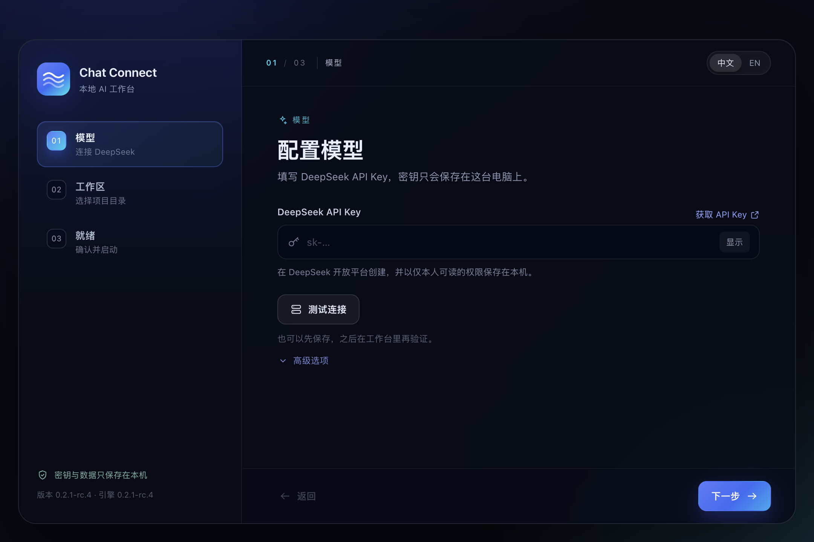
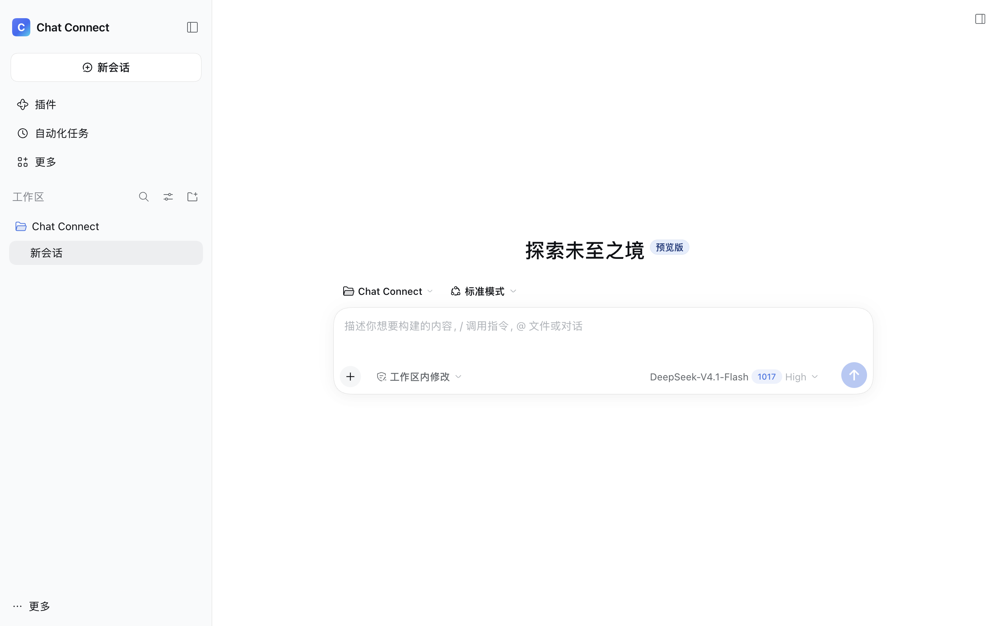
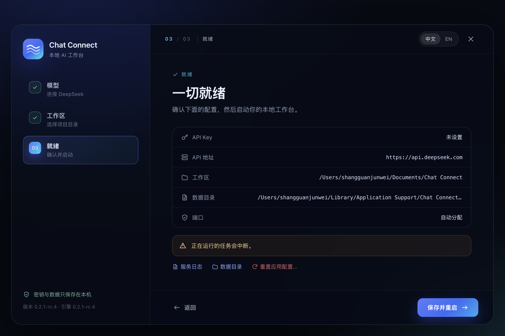

# Chat Connect

> 本地 AI 工作台桌面应用。首次打开用图形向导完成配置，不需要 Node.js、`npx` 或命令行。

`Core 0.2.1-rc.4` · `Electron 45.1.0` · `Node 24.21（内置）` · `MIT`

---

## 目录

- [这是什么](#这是什么)
- [功能](#功能)
- [界面](#界面)
- [快速开始](#快速开始)
- [首次启动做了什么](#首次启动做了什么)
- [数据与配置](#数据与配置)
- [开发指南](#开发指南)
- [打包与分发](#打包与分发)
- [升级引擎](#升级引擎)
- [修改界面](#修改界面)
- [安全设计](#安全设计)
- [常见问题](#常见问题)
- [已知限制](#已知限制)
- [验证情况](#验证情况)
- [开源引擎与版本](#开源引擎与版本)
- [License](#license)

---

## 这是什么

Chat Connect 是一个本地 AI 工作台。它把开源的 Agent 引擎、完整 Web 工作台和配置流程封装成一个原生桌面应用：

- 用户机器上**不需要安装 Node.js、pnpm 或命令行工具**；
- 模型凭据、工作区、引擎数据目录、本地端口全部在应用内配置；
- 配置完成后一键启动，工作台在独立窗口打开；
- 关闭窗口即停止后台服务。

它解决的不是“把 `http://localhost:3080` 套进一个窗口”，而是把首次运行的完整链路产品化：凭据落盘、工作区预置、子进程启动、就绪探测、主题同步、失败诊断都在桌面壳里完成。

> Chat Connect 的品牌、向导、窗口和打包流程属于本项目；底层引擎的版本与归属见 [开源引擎与版本](#开源引擎与版本)。

---

## 功能

- **首次启动配置向导**：API Key、API 地址、工作区、数据目录、端口分步填写，带实时校验与 `/models` 连接测试。
- **图形化设置**：`⌘,` 或菜单随时重新配置，保存后自动停止旧服务、重启并打开新窗口。
- **零环境依赖**：打包内置引擎生产依赖、嵌套依赖和独立 Node 24.21 运行时。
- **开箱即用的工作区**：首次启动会把向导里选择的目录注册到侧边栏，不需要再手动添加。
- **原生窗口体验**：macOS 的配置 / 启动窗口使用无边框标题栏；工作台标题栏跟随浅色 / 深色 / 跟随系统设置。
- **本地优先**：引擎只监听 `127.0.0.1`，API Key 使用系统安全存储加密，凭据文件权限 `0600`。
- **可诊断**：实时显示启动进度；失败时展示服务日志末尾和完整日志路径。
- **安全隔离**：工作台窗口不挂载 preload，网页内容无法调用文件选择、退出或配置接口。

---

## 界面

### 首次配置



1. **模型** — 填写 DeepSeek API Key，可选用代理 / 兼容网关地址，并测试连通性。
2. **工作区** — 选择项目目录；高级选项可指定引擎数据目录与服务端口。
3. **就绪** — 复核摘要，点击「启动工作台」。

### 工作台



### 设置



---

## 快速开始

### 环境要求（仅开发需要）

| 依赖 | 要求 |
| --- | --- |
| 操作系统 | macOS（Apple Silicon 为默认构建目标；Intel 需额外参数）；Windows / Linux 配置已提供但未验证 |
| Node.js | **≥ 22.19**，推荐 24.21（与内置运行时一致） |
| npm | 10+，推荐 11+

打包后的应用不依赖以上任何环境。

### 启动开发模式

```bash
cd /path/to/chat-connect
npm install
npm run dev
```

启动后会自动打开 Electron 窗口并进入配置向导。开发模式有独立的数据目录：

`~/Library/Application Support/Chat Connect (Dev)`

它不会影响正式安装的应用，也不会写入正式版的数据目录。

如果 5173 端口被占用，Vite 会自动换一个端口，不影响使用。

### npm 11.19+ 的安装脚本审批

npm 11.19 起会拦截依赖的安装脚本。仓库的 `package.json` 已通过 `allowScripts` 预先授权所需脚本；如果仍然提示：

```text
install scripts not yet covered by allowScripts
```

执行：

```bash
npm install-scripts approve --all
npm rebuild
```

### Electron 下载慢

Electron 45 的二进制在首次启动时下载，可以使用镜像：

```bash
ELECTRON_MIRROR=https://npmmirror.com/mirrors/electron/ npm install
```

---

## 首次启动做了什么

```
┌──────────────────────────── Chat Connect (Electron) ───────────────────────────┐
│  配置窗口 (preload + sandbox)                                                  │
│    ├─ 选择工作区 / 数据目录                                                     │
│    ├─ 写入 <engine-home>/.credentials.yaml  (0600)                             │
│    └─ 首次启动时预置 <engine-home>/storages/workspace.json                      │
│                                                                               │
│  spawn: resources/node/bin/node --expose-internals .../dsh/lib/bin.js web ...  │
│    env: DSH_HOME, DEEPSEEK_API_KEY, DEEPSEEK_BASE_URL (可选)                   │
│    bind: 127.0.0.1:<自动端口>                                                   │
│                                                                               │
│  等待 http://127.0.0.1:<port>/?token=… 就绪                                     │
│    └─ 打开工作台窗口（无 preload，加载带一次性 token 的本地 URL）                │
└───────────────────────────────────────────────────────────────────────────────┘
```

几个关键点：

- **凭据只有一份**：API Key 同时写入引擎凭据文件和启动环境变量，工作台「设置 → 模型」看到的是同一份凭据。
- **工作区只在全新数据目录预置**：检测到已有工作区记录或会话时跳过，绝不改写用户数据。
- **一次性 token**：本地服务地址带 token，Electron 跟随 303 重定向后获得 HttpOnly 会话 Cookie，之后刷新页面不再需要 token。
- **子进程环境隔离**：启动引擎时会剥离当前终端的 `DSH_*` 变量，避免误用外部 profile / 会话。
- **运行时顺序**：`resources/node/bin/node` → 系统 `node` → Electron 内置 Node。打包版优先使用内置 Node。

### 设置保存后

点击「保存并重启」会：

1. 写入新的 `settings.json`；
2. 停止旧引擎进程；
3. 重新写入凭据、预置工作区（仅首次）；
4. 用新端口启动服务；
5. 打开新的工作台窗口。

### 重置

设置最后一步的 **重置应用配置…** 会清除应用设置和已保存的 API Key，并回到配置向导。它**不会删除**工作区文件、会话记录或引擎数据目录。

---

## 数据与配置

### macOS

| 内容 | 位置 |
| --- | --- |
| 应用设置 | `~/Library/Application Support/Chat Connect/settings.json` |
| API Key | 加密后存入 `settings.json`（Electron `safeStorage`，macOS 走钥匙串） |
| 引擎数据 | `~/Library/Application Support/Chat Connect/engine/` |
| 引擎凭据 | `.../engine/.credentials.yaml`，权限 `0600` |
| 会话记录 | `.../engine/sessions/` |
| 服务日志 | `.../logs/server.log`，每次启动轮换为 `server.previous.log` |
| 默认工作区 | `~/Documents/Chat Connect` |

### 其他平台

- Windows：`%APPDATA%\Chat Connect\`
- Linux：`~/.config/Chat Connect/`

### 开发模式

`~/Library/Application Support/Chat Connect (Dev)`（Windows / Linux 对应 `Chat Connect (Dev)`）。

想重新走一遍向导：退出应用后删除这个目录即可。

### 使用已有的引擎数据目录

在向导第二步的「高级选项」里把 **引擎数据目录** 指向已有的引擎数据目录（例如 `~/.dsh`）。应用检测到已有工作区记录时会跳过预置；但不建议同时让命令行版和桌面版对同一目录执行写操作。

---

## 开发指南

### 常用命令

| 命令 | 作用 |
| --- | --- |
| `npm run dev` | 开发模式：Vite 热更新 + Electron |
| `npm run start` | 预览已构建产物（先执行 `npm run build`） |
| `npm run build` | 编译主进程、preload、渲染层到 `out/` |
| `npm run typecheck` | 三端 TypeScript 类型检查 |
| `npm run package` | 生成未压缩的 `.app` |
| `npm run dist:mac` | 生成 macOS DMG + ZIP |
| `npm run dist:win` | 生成 Windows NSIS 安装包（需在 Windows 上执行） |
| `npm run prepare:node` | 单独准备 `resources/node` |
| `npm run upgrade:core` | 升级引擎依赖（见下文） |

### 为什么不能直接 `npx electron-vite dev`

当前环境（包括部分 Electron 系 IDE / Agent 终端）可能导出 `ELECTRON_RUN_AS_NODE=1`，Electron 会以纯 Node 模式启动，报：

```text
TypeError: Cannot read properties of undefined (reading 'setName')
```

[`npm run dev`](package.json) 实际执行的是 [scripts/run-electron-vite.mjs](scripts/run-electron-vite.mjs)，会先清掉这个变量。手动启动请用：

```bash
env -u ELECTRON_RUN_AS_NODE npx electron-vite dev
```

### 调试

开发模式可以打开远程调试端口：

```bash
CHAT_CONNECT_CDP_PORT=9222 npm run dev
```

然后用任意 CDP 客户端连接 `http://127.0.0.1:9222`。这个开关只在未打包时生效。

### 目录结构

```text
.
├── src/
│   ├── main/                 Electron 主进程
│   │   ├── index.ts          生命周期、单实例、菜单、窗口编排
│   │   ├── controller.ts     启动 / 重启 / 重置 / 状态聚合
│   │   ├── server.ts         引擎子进程、日志、就绪探测
│   │   ├── settings.ts       配置持久化、校验、safeStorage
│   │   ├── credentials.ts    .credentials.yaml 读写
│   │   ├── seed-workspace.ts 首次工作区预置
│   │   ├── runtime.ts        内置 Node / 引擎入口解析
│   │   ├── test-connection.ts /models 连通性测试
│   │   ├── windows.ts        配置窗口 / 工作台窗口 / 主题同步
│   │   ├── workspace-branding.ts 工作台品牌字标注入
│   │   ├── menu.ts           本地化应用菜单
│   │   └── ipc.ts            受信 IPC 接口
│   ├── preload/index.ts      contextBridge 白名单
│   ├── renderer/             React 19 + Vite 配置向导 / 启动页
│   └── shared/types.ts       三端共享类型
├── scripts/
│   ├── run-electron-vite.mjs 清理环境后启动 electron-vite
│   ├── prepare-node.mjs      准备内置 Node 运行时
│   ├── after-pack.cjs        补齐 electron-builder 漏掉的依赖
│   ├── upgrade-core.mjs      一键升级引擎
│   └── make-icon.py          生成 icns / ico / png
├── docs/screenshots/         README 截图
├── build/                    应用图标
├── resources/node/           内置 Node（生成，gitignore）
├── out/                      构建产物（gitignore）
└── release/                  DMG / ZIP / .app（gitignore）
```

---

## 打包与分发

```bash
# macOS Apple Silicon：DMG + ZIP
npm run dist:mac

# 只生成未签名的 .app（调试打包结果）
npm run package

# Windows x64（在 Windows 上执行）
npm run dist:win
```

产物：

- `release/Chat Connect-0.2.1-rc.4-arm64.dmg`（约 313 MB）
- `release/Chat Connect-0.2.1-rc.4-arm64-mac.zip`（约 334 MB）
- `release/mac-arm64/Chat Connect.app`（未压缩约 1.1 GB）

### 内置 Node

[scripts/prepare-node.mjs](scripts/prepare-node.mjs) 会把 Node 24.21 放进 `resources/node`：

- 如果当前 Node 正好是 24.21，直接复制；
- 否则从 nodejs.org 下载对应平台压缩包，并校验 SHA-256。

这样打包应用不依赖用户机器的 Node，也不会出现 Node ABI 与原生模块不匹配的问题。

### electron-builder 的两个坑

1. **peer 依赖**：electron-builder 默认不打包 peer 依赖。`package.json` 里显式列出了引擎的 23 个 peer 包，避免 `dsh-app-boot` 在别的机器上报 `Cannot find package`。
2. **嵌套 `node_modules`**：[after-pack.cjs](scripts/after-pack.cjs) 按 `npm ls --omit=dev --all --parseable` 的结果，把所有缺失的生产依赖（顶层 peer + 嵌套副本，例如每个包自己锁定的 `zod`）补进 `app.asar.unpacked`。

这两步保证应用复制到 `/tmp` 或挂载 DMG 后仍能启动，而不是靠项目目录的 `node_modules` 兜底。

### 签名

当前配置为本地未签名构建（`identity: null`）。对外分发时：

- macOS 需要 Developer ID 签名 + 公证，否则 Gatekeeper 会阻止首次打开；
- Windows 需要代码签名证书，否则 SmartScreen 会提示未知发布者。

未签名构建在本机可以通过右键 → 打开绕过首次拦截。

---

## 升级引擎

### 一键升级（开发者）

```bash
npm run upgrade:core -- 0.2.2       # 指定版本，推荐
npm run upgrade:core                # 查询 npm latest 后升级（会拒绝降级）
npm run upgrade:core -- --dry-run   # 只打印计划，不修改文件
npm run upgrade:core -- 0.2.2 --package # 升级后继续 typecheck + 打包
```

脚本 [upgrade-core.mjs](scripts/upgrade-core.mjs) 会：

1. 把所有 `@deepseek-ai/dsh*` 依赖和应用版本改成目标版本；
2. 执行 `npm install`；
3. 自动处理 npm 11.19+ 的安装脚本审批，并 `npm rebuild` 恢复 `node-pty` / `koffi` 等原生模块；
4. 校验实际安装的 `@deepseek-ai/dsh` 版本；不一致会直接报错，不带着错误依赖树继续；
5. 拒绝降级；回滚需要显式 `--force`；
6. 对比引擎的 Node engine 与 `prepare-node.mjs` 的 `NODE_VERSION`，并提示检查 `seed-workspace.ts` 的存储版本。

> `npm view @deepseek-ai/dsh version` 返回的是 `latest` dist-tag，可能指向比当前更旧的预发布版（例如项目在 `0.2.1-rc.4`，latest 却是 `0.2.1-rc.2`）。因此实际升级建议显式写目标版本，不要盲目依赖 latest。

### 手动升级

```bash
# 1. 修改 package.json 中所有 @deepseek-ai/dsh* 为同一版本
# 2. 重新安装
npm install

# 3. 检查依赖树
npm ls @deepseek-ai/dsh --depth=0

# 4. 重新构建、检查、打包
npm run typecheck
npm run build
npm run dist:mac

# 5. 把 .app 复制到 /tmp 或挂载 DMG 启动验证
```

升级后重点确认：

- `src/main/seed-workspace.ts` 的工作区存储域版本是否仍与上游一致；
- 引擎是否改变了 `dsh web` 参数、环境变量或凭据格式；
- 新的 Node engine 是否高于 `prepare-node.mjs` 中的 24.21；
- 打包产物在项目目录外能否启动。

---

## 修改界面

| 范围 | 难度 | 改哪里 |
| --- | --- | --- |
| 向导文案、步骤、校验 | 低 | [SetupWizard.tsx](src/renderer/src/views/SetupWizard.tsx) |
| 颜色、间距、圆角、动画 | 低 | [styles.css](src/renderer/src/styles.css) |
| 中英文文案 | 低 | [i18n.ts](src/renderer/src/i18n.ts) |
| 启动 / 失败页 | 低 | [BootScreen.tsx](src/renderer/src/views/BootScreen.tsx) |
| 窗口大小、标题栏、主题同步 | 低 | [windows.ts](src/main/windows.ts) |
| 菜单 | 低 | [menu.ts](src/main/menu.ts) |
| 新增一个配置项 | 中 | `shared/types.ts` → `settings.ts` → 向导 → `server.ts` |
| 工作台换肤（CSS 变量） | 中 | 用 `webContents.insertCSS` 覆盖 `--dsw-*` 变量 |
| 工作台品牌字标 | 低 | [workspace-branding.ts](src/main/workspace-branding.ts) |
| 工作台新增组件 / 按钮 | 中高 | 客户端插件 + Slot，需按上游插件规范构建 |
| 工作台布局 / 交互深度改造 | 高 | 从引擎源码构建并替换运行时 |

工作台本身是官方编译产物（`@deepseek-ai/dsh-web-frontend/dist`），不是本仓库源码。只改主题可以用 CSS 变量；改结构需要插件或源码构建。

---

## 安全设计

- 所有窗口：`contextIsolation: true`、`sandbox: true`、`nodeIntegration: false`，拒绝 `<webview>` 挂载。
- **只有配置窗口挂载 preload**。工作台窗口不注入任何桌面 API。
- IPC 处理前校验发送方窗口 ID，工作台页面无法伪造调用。
- 工作台导航限制在本地服务同源；`window.open` 和外部链接交给系统浏览器。
- 系统权限只放行剪贴板、通知、媒体和全屏。
- API Key 用 `safeStorage` 加密；引擎凭据文件权限 `0600`。
- 服务只监听 `127.0.0.1`，不对外暴露。

需要明确的边界：Agent 的工具进程和应用以同一个 OS 用户运行，因此能读取你有权限读取的文件，包括凭据文件。桌面壳隐藏的是“API 面”，不是操作系统权限边界。

---

## 常见问题

**启动时提示“未找到内置的本地引擎”**

开发环境先执行 `npm install`。打包后出现通常意味着 `asarUnpack` 未生效，检查 `Chat Connect.app/Contents/Resources/app.asar.unpacked/node_modules/@deepseek-ai/dsh`，必要时重新 `npm run dist:mac`。

**首次启动失败 / 端口被占用**

向导里把端口设为 `0` 使用系统分配端口。失败页可以查看日志，也可以点击「修改配置」换端口后重试。

**系统弹出钥匙串授权**

应用用 Electron `safeStorage` 加密 API Key，macOS 会请求访问登录钥匙串。选择“始终允许”即可；拒绝授权后应用仍可启动，但下次需要重新填写 Key。

**从终端启动时应用闪退**

终端导出了 `ELECTRON_RUN_AS_NODE=1`。用 `npm run dev`，或手动：

```bash
env -u ELECTRON_RUN_AS_NODE "release/mac-arm64/Chat Connect.app/Contents/MacOS/Chat Connect"
```

Finder / Dock 双击不受影响。

**为什么打包体积这么大？**

内置了引擎的完整生产依赖、各包嵌套的 `node_modules`、Office / 语音等本地组件，以及独立 Node 运行时。未压缩 `.app` 约 1.1 GB，DMG 约 313 MB。

**应用内怎么升级？**

当前版本没有接入自动更新。计划使用 GitHub Releases + `electron-updater`；macOS 未签名时无法可靠自动替换，正式分发需要签名与公证。目前请下载新 DMG 覆盖安装。

**支持 DeepSeek 账号登录吗？**

目前只支持 API Key。引擎的账号授权记录结构可以后续接入，但向导尚未提供扫码 / 设备码登录。

---

## 已知限制

- 未签名构建；对外分发需要 Apple Developer ID / Windows 代码签名。
- macOS 默认只构建 arm64；Intel 需要调整 `electron-builder.yml` 或传 `--x64`。
- Windows / Linux 配置已提供，但未在真实机器上完成打包验证。
- 暂不支持应用内自动更新。
- 暂不支持 DeepSeek 账号 OAuth 登录。
- 工作台主题同步采用 1 秒轮询页面 `data-ds-theme-source`，切换主题最多约 1 秒后原生标题栏生效。
- 上游处于开发者预览阶段，跨版本升级可能存在破坏性变更。

---

## 验证情况

在 macOS 27.0.1 (arm64) 上完成：

- 开发模式：`npm run dev` → 配置向导 → 保存 → 启动引擎 → 自动打开工作台。
- 打包模式：`npm run dist:mac` → 全新数据目录 → 中文向导 → 内置 Node 启动 → 工作台出现预设工作区。
- 可移植性：`.app` 复制到 `/tmp` 启动成功；挂载 DMG 从只读卷启动成功。
- 主题同步：工作台切浅色 / 深色，`prefers-color-scheme` 与原生窗口外观同步变化。
- 升级脚本：dry-run 能列出目标版本；降级会被拒绝；安装后会校验实际版本。
- 服务重启：设置保存后停止旧服务、新端口启动、工作台窗口重建。
- 退出：关闭工作台窗口后应用退出，引擎子进程被回收。
- 失败路径：无效 API Key 时 `/models` 返回 401，界面显示错误；启动失败显示日志尾部与路径。

> 没有可用 API Key，因此只验证到 `/models` 401；未验证一次成功的模型推理。

---

## 开源引擎与版本

- Chat Connect 内置的引擎固定为 DeepSeek Harness `0.2.1-rc.4`（`@deepseek-ai/dsh@0.2.1-rc.4`，对应仓库 tag `dsh-v0.2.1-rc.4`）。
- 只使用引擎公开的 CLI（`dsh web`）、凭据文件与存储格式，不修改引擎源码。
- 桌面包版本与引擎版本保持同步；升级时一起改。
- 上游升级后，按 [升级引擎](#升级引擎) 的流程更新并重新验证。

## License

MIT。Chat Connect 的桌面壳、配置向导和打包脚本采用 MIT 许可证。

内置的 DeepSeek Harness 引擎由 DeepSeek AI 开发，遵循 MIT 许可证；其版权与许可声明保留在依赖包、About 面板与本文档的“开源引擎与版本”一节中。

第三方依赖的许可证随依赖一起分发，详见各包的 `LICENSE` 与 `THIRD_PARTY_NOTICES`。
